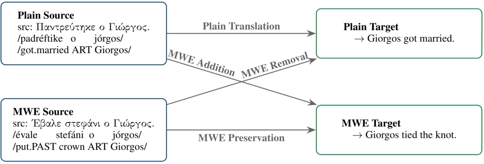

# Dialect Normalization using Large Language Models and Morphological Rules
While neural machine translation (NMT) has achieved remarkable parity with human performance in general domains, handling multi-word expressions (MWEs) remains a persistent challenge, particularly in low-resource settings. This difficulty is twofold: models need not only decode the non-compositional meaning of MWEs but also navigate the stylistic choice between idiomatic ("MWE") and literal ("plain") outputs. In this study, we introduce a new 4-way parallel dataset for Greek and English, comprising of Greek and English MWE and plain sentences. We evaluate the style-transfer and style-switching capabilities of state-of-the-art Large Language Models (LLMs) across four tasks. Using traditional metrics, we demonstrate that LLMs often struggle with style-aware translation. Furthermore, we introduce StyleCOMET, a fine-tuned quality estimation metric to better evaluate stylistic nuances. Our results suggest that current limitations in MWE translation are a product of both model inability and metric-level insensitivity to idiomaticity.

Visualization:


# Instructions
The scripts provided in the "code" directory use, and produce, the data files provided in the "data" directory.

Example usage of a script:
```
python3 use_comet_ground.py
```
